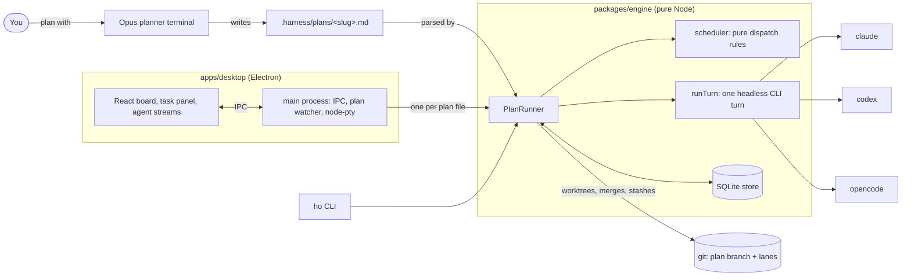
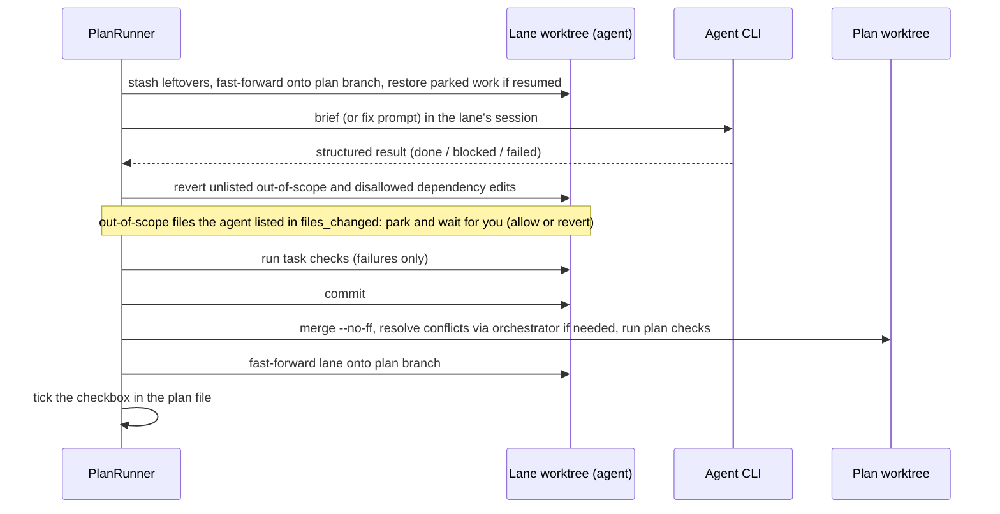
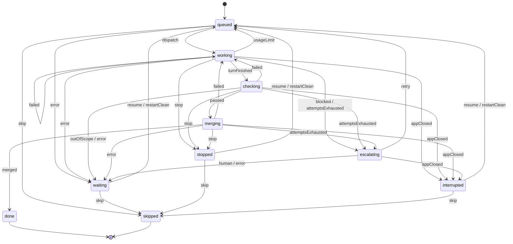

# Architecture

How harnessOrch works today: the parts, how a plan runs, where state lives, and the task state machine. The README covers using the app. This document covers how it works inside.

## In one picture

- **The engine is deterministic.** No LLM runs the loop. LLMs are called only as workers, as the orchestrator at decision points, and as reviewers.
- **The engine has no Electron.** The desktop app and the `ho` CLI share it. Its public API is `packages/engine/src/index.ts`.
- **The desktop is a thin host.** `apps/desktop/src/main/index.ts` keeps one `PlanRunner` per plan file (`runnerFor`) and exposes its methods as `ipcMain.handle` channels (`plan:start`, `plan:stopTask`, `plan:resume`, …). It forwards every runner `"event"` to the renderer, plus a Windows notification for `needs-you` and `ready`.

## The parts

| Module (`packages/engine/src/`) | Job |
|---|---|
| `plan/` | Parse and validate the plan file (YAML header plus `- [ ] **T1 — Title**` tasks, each with a YAML block). It also writes checkboxes and agent overrides back. |
| `scheduler/` | Pure: which queued tasks may start now. |
| `engine/runner.ts` | `PlanRunner`: the loop, one task's life, merges, escalation, reviews, host actions. |
| `engine/lifecycle.ts` | Task states, the transition table, `transition()`. Pure. |
| `engine/git.ts`, `git/` | Worktrees, lane sync, merges, stash park and restore. |
| `engine/deps.ts` | The dependency rule (dev deps allowed, prod deps reverted unless listed) and installs. |
| `agents/turn.ts` | `runTurn`: one headless turn of one CLI with lean flags, parsed by a per-agent reducer into `TurnResult`. |
| `brief/` | Task briefs (≤ 2k tokens), fix prompts, session handoffs, the worker result schema. |
| `checks/` | Run check commands, filter output down to failures, find write-scope violations. |
| `orchestrator/` | Decision prompt (retry, reassign, amend or human) and merge-conflict prompt. |
| `review/` | Diff-only review prompt and verdict schema. |
| `ledger/` | Effective-token weighting, the live `budgetWatcher`, pricing. |
| `store/` | SQLite through `node:sqlite`: plans, tasks, lane sessions, runs, reviews, events. |
| `skills/`, `planner/` | Skill selection per role. The planner session's prompt and flags. |
| `util/` | Process spawning with containment (a kill takes the whole process tree), streaming, env scrubbing. |

## How a plan runs

### The loop

`PlanRunner.run()` → `loop()`:

1. `prepare()` once. It creates the plan branch and its worktree, syncs task rows from the plan file, and recovers tasks the last app session left in flight (see [After the app closes](#after-the-app-closes)).
2. Every task that is `interrupted` is resumed, so Start continues them.
3. Repeat until stopped:
   - reload the plan file (you may have edited it);
   - ask the scheduler for dispatches and start each one as `runTask` (tracked in `inflight`);
   - start reviews for authors whose tasks are all finished;
   - if nothing is in flight: return `ready` (all done and reviewed), wait for a usage limit to lift, or return `paused` (something needs you);
   - otherwise wait for any task to finish, or for a host action (resume, skip, hand back) to wake the loop.

Everything runs in one Node process. Concurrency comes from promises, not threads. Merges into the plan branch are serialized through `serialMerge` (a promise chain), so two tasks never merge at once.

### Scheduling rules (`scheduler.ts`)

- **Dependencies:** every dependency is `done` or `skipped`. Any other state holds back that task's dependents only.
- **One task per agent at a time:** each agent has one lane and one session.
- **Concurrency:** at most `concurrency` tasks in flight (default 3, overridable per plan).
- **Write scopes:** tasks whose write scopes overlap never run together.
- **Agent choice:** the first candidate agent wins. A later one is used only while every earlier one is at its usage limit. A busy agent is not a reason to switch.

### One task, start to finish

If anything fails (no valid result, checks, merge, plan checks), the same session gets a fix prompt with the filtered failure and the task tries again. After `maxAttempts` (default 3) the task escalates. A `blocked` result escalates at once.

**Escalation** (`escalate`) asks the orchestrator once per task, Codex first and then Opus. It can retry in place (same session, edits kept, only guidance sent), reassign to another agent (edits parked, fresh brief there), amend the task's checks when one cannot run at all (written to the plan file and memory, then a retry in place; an amend that would drop a check is refused), or hand the task to you. A task handed to you is `waiting`, with its edits parked on the stash.

### Reviews

When none of an author agent's tasks can still change, a different agent reviews that author's commits as one diff, read-only. If it rejects, the author fixes the findings in its own lane session, and the fix merges and gets re-reviewed, up to `maxReviewRounds` (default 2). After that the review needs you. Reviews sit outside the task state machine: they work on `done` tasks and never change their state.

### Host actions (methods on `PlanRunner`)

| Action | What it does |
|---|---|
| `run()` / `stop()` | Run the loop. `stop()` means no new dispatches. A task between fix rounds stops there. |
| `stopTask(id)` / `stopAll()` | Kill a task's turn or check now and park its edits. During a merge the stop waits until the merge is done. `stopAll` = `stop()` + `stopTask` on everything in flight. |
| `stopInfo(id)` | The facts the Stop confirm shows: elapsed time, tokens so far, files to park, dependents that will wait. |
| `resumeTask(id, {guidance, agent})` | From `waiting`, `stopped` or `interrupted`. Restores parked edits on the same agent, or starts fresh on another agent. |
| `restartClean(id)` | Drop parked edits and attempts. The next turn gets a fresh brief. |
| `skipTask(id)` | The task counts as finished without a commit, so its dependents can run. |
| `resolveReview(agent, approve or retry)` | Unblock a review that needs you. |
| `hold(agent)` / `release(agent)` | You take over an agent's lane in a real terminal. No dispatches go to it until you hand it back. |
| `mergeToBase()` | Merge the plan branch into the base branch, once everything is done and reviewed. |

## Task state machine

The authoritative graph is `TRANSITIONS` in `packages/engine/src/engine/lifecycle.ts`. Every state change in the runner goes through one private `setState(taskId, event)`, which calls `transition()` and throws on an illegal move. The diagram below is checked against that table by `test/lifecycle.test.ts`. If you change one, change the other.

The states fall into four groups. The board columns and the scheduler both use these groups.

| Group | States | Meaning |
|---|---|---|
| Planned | `queued` | Waits for its dependencies, a free agent and a free write scope. |
| Running (`IN_FLIGHT`) | `working`, `checking`, `merging`, `escalating` | The engine is doing something. |
| Needs you (`NEEDS_YOU`) | `waiting`, `stopped`, `interrupted` | Nothing runs until you act. Holds back dependents. |
| Finished (`FINAL`) | `done`, `skipped` | Satisfies dependents. No way out. |

Who fires each event:

| Event | Fired by |
|---|---|
| `dispatch` | The loop starts `runTask`. |
| `turnFinished` | The agent returned a `done` result; checks start. |
| `failed` | Any failed attempt with attempts left: no valid result, timeout, budget kill, the agent reports failure, checks, conflict, or plan checks. Leads to a fix round. |
| `blocked`, `attemptsExhausted` | `escalate()`. |
| `usageLimit` | The agent is at its limit. Edits are discarded and the task is requeued for the next agent. |
| `passed`, `merged` | `complete()` and the merge into the plan branch. |
| `retry`, `human` | The orchestrator's decision. |
| `stop` | `stopTask`/`stopAll`. It also fires when a plan-wide `stop()` is seen between fix rounds. During `merging` it is applied only once the merge has failed. |
| `appClosed` | `prepare()` finding a task the last process left in flight. |
| `resume`, `restartClean`, `skip` | Host actions. |
| `error` | The engine itself threw while running the task (`track()`). |

**Telling a stop from a budget kill.** Both arrive as `TurnResult.aborted`. The runner checks the task's own `AbortController`: if it fired, the event is `stop`, otherwise `failed`.

**Stopping.** `runTask` creates one `AbortController` per task. Its signal goes to `runTurn` and on to `streamProcess`, and to the task's checks (`runChecks` → `spawnLogged`). Both kill the whole process tree on abort and report `aborted: "stopped by you"`. Orchestrator, conflict and review turns don't get the signal, which is why `escalating` can't be stopped and a merge finishes before a stop applies.

### After the app closes

Any task row still in a running state when a new process calls `prepare()` belonged to a dead process. `recover()` handles it:

- **`merging`, and the task's commit is on the plan branch:** `done`. The merge landed.
- **`merging`, committed but not merged:** the commit is undone back into edits.
- **Otherwise:** the lane's uncommitted edits are parked under the task's stash label, a note says what it was doing ("codex was working when the app closed; its edits are kept"), and the task becomes `interrupted`. An interrupted escalation also clears `orchestrated`, so the orchestrator is asked again.

Start then resumes every `interrupted` task: edits restored, same session if one was saved.

## Where state lives

| What | Where |
|---|---|
| Plans, tasks, lane sessions, runs (the token ledger), reviews, events | SQLite, `~/.harnessorch/harness.db` (`store/store.ts`). Tables are `CREATE TABLE IF NOT EXISTS`. New columns are added with `ALTER TABLE` guarded by `PRAGMA table_info` in the `Store` constructor, which also migrates old task statuses (`pending`→`queued`, `running`→`interrupted`, `paused`→`waiting`). |
| Turn logs (raw JSONL) and check output | `~/.harnessorch/<project-id>/<slug>/logs` and `…/checks` |
| The plan and its checkboxes | `.harness/plans/<slug>.md` in your repo. The runner is the only writer of checkboxes. |
| Plan branch and its worktree | `harness/<slug>`, at `<repo>/../.harness-wt/<repo>/<slug>/plan` |
| One lane per agent | branch `harness/<slug>--<agent>`, worktree `…/<slug>/<agent>` |
| Parked edits | `git stash` in the lane, labelled `harnessOrch <slug> <task> (paused)`. Leftovers found before a task are stashed as `harnessOrch leftover before <task>`. |

**In memory only, lost when the process exits:** orchestrator and human guidance not yet used, reassignments, the "restore parked work" flag, the abort controllers, live token counters, review "fix first" flags and blocked-review markers. If the app closes after you've typed guidance but before the task runs, the guidance is gone. The task itself is recovered.

## Token discipline

This is why the project exists: the old harness spent most of its tokens on context replayed into workers.

- **Lean workers.** `runTurn` runs each CLI headless with no user config, MCP servers, plugins or slash commands, and a restricted tool list (read-only for orchestrator and review turns).
- **One session per agent per plan** (a "lane"), resumed across tasks to keep the prompt cache warm. When a turn's context passes `sessionCeilingTokens` (150k), the session rotates: the next task starts fresh with a short handoff of what that agent already did.
- **Small inputs.** Briefs stay at or under 2k tokens. Check output is filtered to failures. Skills are passed as file paths, at most 2 per brief.
- **Budgets.** `budgetWatcher` kills a Claude or OpenCode turn live once its effective tokens pass the task budget (`taskTokenBudget`, or 3× the median of past runs). Codex reports usage only at turn end, so only its timeout stops it.
- **Usage accounting differs per CLI:** Claude repeats a request's usage on every content block (count once per `message.id`). Codex's `turn.completed` is cumulative per thread (store `threadTotals`, record the difference). OpenCode reports per `step_finish`. Effective tokens weight cache reads ×0.1 and writes ×1.25.

## Changing the design

- **New task state or event:** add it to `TaskState`/`TaskEvent` and `TRANSITIONS`, give it `STATE_INFO` text, fire it through `setState` in the runner, and update the diagram above. `lifecycle.test.ts` fails until the diagram matches. The desktop keeps its own copy of the state list in `apps/desktop/src/renderer/src/api.ts`.
- **New store column:** a guarded `ALTER TABLE` in the `Store` constructor, plus `TaskRow` and the `updateTask` encoder.
- **New host action:** a `PlanRunner` method, an `ipcMain.handle` channel in `apps/desktop/src/main/index.ts`, and a UI call through `api.call`. After changing the engine, run `npm run build -w packages/engine` before typechecking the desktop.
- **Worker flags or context:** measure the token cost first. See CLAUDE.md.
