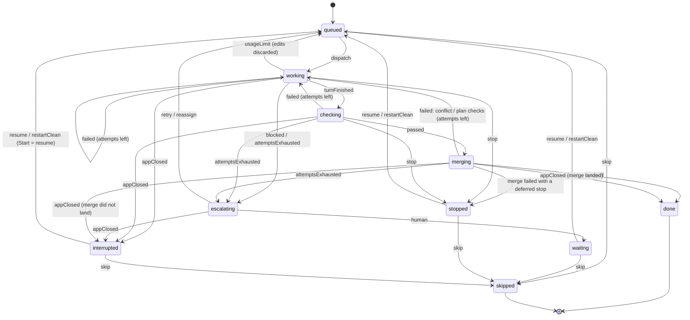

# Task lifecycle state machine, Stop and interrupted tasks

## Context

A task has 4 statuses (`pending | running | done | paused`, `packages/engine/src/scheduler/scheduler.ts:4`). "running" hides many different situations, and the only signal is a free-text `note`. The live run on 2026-10-22 showed three gaps:

1. **After the app closed mid-run, nobody knew what would happen to in-flight tasks.** Today `prepare()` quietly turns `running` into `pending` (`runner.ts:161`). Then `runTask` stashes the lane's half-finished edits as "leftover before Tn" and starts from a fresh brief, so that work ends up in a stash nothing restores.
2. **You can't tell what stopping does.**
3. **There is no way to stop one task.** `stop()` is plan-wide and only stops *new* dispatches.

**Decisions from the grilling session:**
- **Our own typed transition table.** No XState and no LangGraph. The scheduler's dependency graph stays as it is.
- **Stop kills the agent and parks its edits.** It kills the agent's process tree at once and parks uncommitted edits with the existing stash mechanism. The task becomes `stopped`, and its dependents wait. From there you choose Resume (restore the edits, same session), Restart clean (drop the edits), or Skip.
- **On restart, in-flight tasks show as `interrupted`,** saying what they were doing. Start continues them like Resume (same session, edits restored). Restart clean and Skip are also offered.
- **Stop is available per task, and as a real Stop all.** Stop all gives every in-flight task the same kill-and-park treatment. Reviews and orchestrator turns can't be stopped (out of scope).
- **Stop opens an inline confirm that lists the facts** (no browser dialog): what gets killed, the turn's elapsed time and tokens so far, how many files get parked, which dependents will wait, and what you can do afterwards.

## States and transitions

> Implemented 2026-10-22. The current graph is in [docs/architecture.md](../architecture.md#task-state-machine), and a test keeps it in sync with `TRANSITIONS`. The diagram below is the planning version.

New file `packages/engine/src/engine/lifecycle.ts`. It contains only types, `TRANSITIONS` and `transition()`, with no I/O.

```
TaskState = queued | working | checking | merging | escalating
          | waiting   (needs you: blocked question / attempts exhausted; today's "paused")
          | stopped | interrupted | done | skipped
```



| From | Event | To |
|---|---|---|
| queued | dispatch | working |
| queued | skip | skipped (`skipTask` accepts pending tasks today) |
| working | turnFinished | checking |
| working | failed (attempts left): no valid result, timeout, budget kill, or the agent reports `failed` | working (fix round) |
| working | blocked / attemptsExhausted | escalating |
| working | usageLimit | queued (edits discarded, as today) |
| checking | passed | merging |
| checking | failed (attempts left) | working (fix round) |
| checking | attemptsExhausted | escalating |
| merging | merged (plan checks pass) | done |
| merging | failed (attempts left): conflict or plan checks | working. A plan-check failure keeps the merge and fixes forward; an unresolved conflict resets the lane (`mergeLane`) |
| merging | attemptsExhausted | escalating |
| merging | stop, applied once the merge failed | stopped (nothing to park: the lane was already reset or the merge kept) |
| escalating | retry / reassign | queued |
| escalating | human | waiting |
| waiting, stopped, interrupted | resume | queued (restore flag set) |
| waiting, stopped, interrupted | restartClean | queued (parked stash dropped, attempts 0) |
| waiting, stopped, interrupted | skip | skipped |
| working, checking | stop | stopped. This includes the Stop all check at the top of a fix round (`runTask`), which today writes `pending` |
| working, checking, escalating | appClosed (seen in `prepare`) | interrupted |
| working, checking, merging, escalating | error (the engine crashed on the task) | waiting |
| merging | appClosed (seen in `prepare`) | done if the merge landed (`commitsOf` / plan branch log), else interrupted |
| merging | stop | deferred until the merge finishes (git must not be left half-merged). Merging can include an orchestrator conflict turn and the plan checks, so the wait can be minutes; the confirm says so. It then ends `done` or, if the merge failed, `stopped` |

- `transition(state, event)` throws on an illegal move.
- Each state carries a `next` description and an `ifStopped` description, which the UI and the confirm text use.
- Every status write in `runner.ts` goes through one private `setState(taskId, event, extra)`. It calls `transition()`, writes the store, and emits the existing `"task"` event with the new `state`.
- **Satisfying dependencies:** `done` and `skipped` satisfy dependents. Every other state holds them back. This keeps the scheduler's rule ("a paused task holds back only its dependents") and widens it to all non-final states.
- **A stop is not a failure.** A budget kill and a user stop both come back as `r.aborted`. `runTask` decides with the task's `controller.signal.aborted`: if it is set, the event is `stop`; otherwise it is `failed`. Without this, a stop becomes a fix round.
- **`skipped` is not authored work.** Once `skipTask` writes `skipped`, audit the code that filters `status === "done"` (handoff, `reviewable` authors, review diffs, `readyToMerge`). Review and handoff keep reading `done` only. Anything about dependencies or "all tasks finished" reads `done | skipped`.
- **Interrupted escalations get the orchestrator back.** `escalate` sets `orchestrated: true` before the orchestrator's turn. When `prepare()` interrupts an `escalating` task, it clears `orchestrated`, so the next failure asks the orchestrator again instead of going straight to `waiting`.

## Changes

**Engine (`packages/engine`):**
- **`scheduler/scheduler.ts`:** `TaskStatus` becomes `TaskState` from `lifecycle.ts`. Dispatch reads `queued`, and dependency checks read `done | skipped`.
- **`store/store.ts`:**
  - Status values change. The constructor migration maps `pending` to `queued`, `running` to `interrupted`, and `paused` to `waiting`. A `skipped` task, which `skipTask` currently writes as `done` with a summary, keeps `done`.
  - New columns `phase_started_at` and `turn_started_at`, so the confirm can show elapsed time. Add them with `ALTER TABLE` guarded by `PRAGMA table_info`, the same pattern as `thread_totals`.
- **`util/stream.ts`:** add `signal?: AbortSignal` to `StreamOptions`. On abort, call `killProcessTree(child)` and return `aborted: "stopped by you"`. Also add `signal` to `TurnRequest` (`agents/turn.ts`) and pass it through in `runTurn`.
- **Checks runner (`checks/`):** accept the same `signal` so `checking` can be stopped. It kills the running check process.
- **`engine/runner.ts`:**
  - Keep a `Map<taskId, AbortController>` per in-flight task, created in `runTask` and passed to `turn()` and `verify()`.
  - **`stopTask(id)`:**
    - In `working` or `checking`: abort the controller. `runTask` sees the result is aborted and parks the edits, using the existing `park()` and `parkLabel()`. The task then becomes `stopped`.
    - In `merging`: set a flag. Once the merge finishes, the task ends `done`, or `stopped` if the merge failed (conflict or plan checks) instead of starting a fix round.
    - In any other state: throw.
  - **`stopAll()`:** `stop()` (no new dispatches) plus `stopTask` on every in-flight task.
  - **`restartClean(id)`:** drop the parked stash (`findStash` plus `git stash drop`), set attempts to 0, then `transition(restartClean)`.
  - **`resumeTask`** stays as it is. It works from `waiting`, `stopped` and `interrupted`. The existing restriction that a bare resume of a blocked *question* needs an answer or another agent still applies, but only to `waiting`.
  - **`prepare()`:** for each task left in `working`, `checking` or `escalating`, park that agent's lane edits under the task's `parkLabel` (lane = `task.agent` worktree), record what it was doing in `note` ("Claude turn killed when the app closed; edits kept"), then set `interrupted`. If a task was in `merging`, check whether the merge landed (`commitsOf` or the plan branch log) and set `done` or `interrupted` to match.
  - **`run()` on Start:** before dispatching, apply `resume` to every `interrupted` task, so Start continues them.
  - **`stopInfo(id)`:** returns the facts for the confirm:
    - the agent and its turn's elapsed time;
    - tokens so far, from the live `budgetWatcher` total, which needs exposing per task. Claude and OpenCode only; for Codex, "reported when the turn ends";
    - the number of uncommitted files, from `changedPaths(lane.path)`;
    - the dependents that will wait (transitive `depends_on` among non-final tasks);
    - whether the stop is deferred because a merge is in progress.
  - **Tokens so far:** `budgetWatcher` (`ledger/effective.ts`) also returns its running total, through a getter on the returned function or a small object. `turn()` stores it per task for `stopInfo`.
- **`index.ts`:** export `TaskState`, `TRANSITIONS` and the new runner methods.

**Desktop (`apps/desktop`):**
- **`src/main/index.ts`:** IPC handlers `stopTask`, `stopAll`, `restartClean` and `stopInfo`, next to the existing `resumeTask` and `skipTask`.
- **`Board.tsx`:** columns or groups by state. Needs you holds `waiting`, `stopped` and `interrupted`, each with a badge naming its reason. Running cards show the sub-state (working, checking, merging, escalating) and the state's `next` text.
- **`TaskPanel.tsx`:**
  - On a running task, a Stop button opens the inline confirm, built from `stopInfo` and the state's `ifStopped` text. Its buttons are "Stop task" and "Keep running".
  - On `stopped` or `interrupted` tasks, the actions are Resume, Restart clean and Skip.
- **`StatusStrip.tsx` / `App.tsx`:** the plan-level Stop calls `stopAll`. Its confirm lists the in-flight tasks.

## Out of scope

- Stopping reviews or orchestrator turns.
- A gentle "stop after this turn".
- Library state machines and graph runtimes.
- Changes to scheduling, routing or the plan file format.

## Before starting

The working tree has the uncommitted dependency fix (`deps.ts` `staleDeps`, `git.ts` dot-entry copies, runner install step, tests). Commit it separately first.

## Verification

- **`lifecycle.test.ts` (new):** every legal transition, and illegal ones throw. This covers the edges `working --failed--> working`, `merging --failed--> working`, `merging --attemptsExhausted--> escalating`, `merging --appClosed--> done | interrupted` and `queued --skip--> skipped`. A table-driven test asserts that every non-final state has `next` and `ifStopped` text.
- **Coverage check:** every `store.updateTask(... status ...)` call site in `runner.ts` goes through `setState` and maps to one row of the table.
- **`runner.test.ts` (existing fake-`runTurn` harness)**, new cases:
  1. **Stop while working.** The fake turn awaits the request's `signal`. `stopTask` makes the turn return `aborted`, and the task becomes `stopped`. Its edits are on the stash with `parkLabel`, its dependent stays `queued`, and another independent task still finishes.
  2. **Resume after a stop** restores the parked edits and reuses the same session. **Restart clean** drops the stash and the next turn gets a fresh brief.
  3. **Stop while checking:** the check's runner is aborted and the task becomes `stopped`.
  4. **Stop during a merge** is deferred, and the task ends `done`. **Stop during a merge that conflicts** (the fake orchestrator can't resolve it) ends `stopped`, not `working`.
  4b. **A budget kill is still a fix round:** an aborted turn without a stop goes to `working` with attempts + 1, not `stopped`.
  5. **Interrupted.** Simulate an app close: a store row left `working` with uncommitted lane edits, then a new `PlanRunner`. `prepare()` produces `interrupted` with the edits parked. `run()` continues it with the edits restored, and the stash is no longer left as "leftover".
  6. **`stopAll`:** two in-flight tasks both become `stopped`, and nothing new dispatches.
- **`stream.ts`:** a test where an aborted `signal` kills a real child process tree (reuse the `test/fixtures/detached-child` pattern from `process-containment.test.ts`).
- Run `npm test`, `npm run typecheck`, `npm run lint`, then `npm run build -w packages/engine && npm run typecheck -w apps/desktop`.
- **Manual, in the desktop app (`npm run desktop`)** on a small plan:
  1. Press Stop on a running task. Check the confirm's facts, confirm, and see the card under Needs you as `stopped`. Resume it.
  2. Start a run, close the app mid-turn, and reopen it. The task shows as `interrupted` with a reason. Pressing Start continues it with its edits.
